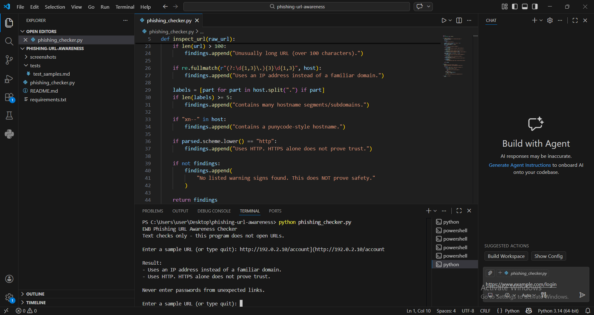
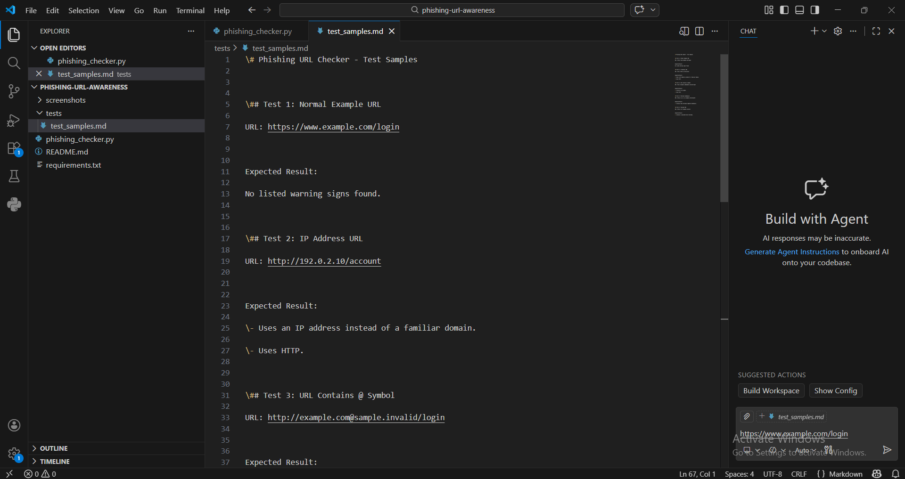

# EWB Phishing URL Awareness Checker

## Overview

Phishing is a type of social engineering attack that tricks users into sharing sensitive information through fake websites, emails, and malicious links.

The **EWB Phishing URL Awareness Checker** is a beginner-friendly Python-based cybersecurity project that checks URLs for common suspicious characteristics.

It helps users understand possible warning signs in a URL before deciding whether to trust it.

## Features

The tool checks for the following suspicious URL characteristics:

- Detects the `@` symbol in a URL.
- Flags URLs longer than 100 characters.
- Detects IP addresses used as hostnames.
- Flags URLs with five or more hostname labels.
- Detects the `xn--` punycode marker.
- Identifies URLs using HTTP instead of HTTPS.
- Allows users to check multiple URLs continuously until they enter `q` to quit.

## Technologies Used

- Python
- Visual Studio Code
- GitHub

## Requirements

- Python 3.10 or above
- No additional Python packages required.

## How to Run

1. Download or clone this repository.
2. Open the project folder in Visual Studio Code.
3. Open the terminal.
4. Run the following command:

```bash
python phishing_checker.py
```

5. Enter a URL when prompted.
6. Enter `q` to exit the program.

## Sample URLs for Testing

| Test | URL |
|---|---|
| Normal URL | `https://www.example.com/login` |
| IP address | `http://192.0.2.10/account` |
| @ symbol | `http://example.com@sample.invalid/login` |
| Multiple hostname labels | `https://a.b.c.d.e.example.invalid/path` |
| Punycode | `https://xn--example.invalid/` |

## Screenshots

### Sample Run



### Test Results



## Project Limitations

- This is an educational awareness tool.
- It checks URL text only.
- It does not open websites or visit URLs.
- It does not verify whether a website is genuinely safe or malicious.
- A URL with no warning signs is not guaranteed to be safe.

## Ethical Use

This project is created for educational purposes to improve phishing URL awareness and support cybersecurity learning.

Always use cybersecurity tools responsibly and ethically.

## Author

**Aswani KP**

AI-Powered Cybersecurity | EWB Courses

## Repository

[Phishing URL Awareness Checker](https://github.com/aswani-cyber/phishing-url-awareness)

